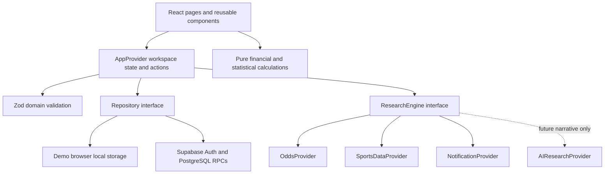

# Architecture

EdgeLab is one maintainable Next.js App Router application. It runs locally without infrastructure. The default workspace is a clearly labelled synthetic demonstration, with browser persistence. An optional Supabase workspace provides authenticated private records and starts empty.

## Boundaries

`src/lib/domain/types.ts` defines shared entities. Bets and paper predictions are distinct collections. Bet legs capture exact markets, selections, thresholds and individual outcomes/statistics. Candidates retain odds and probability provenance. Predictions are registered snapshots; settlement can change outcomes without replacing the original forecast.

`src/lib/domain/calculations.ts` contains pure deterministic functions. Integer cents avoid accumulating floating-point currency errors. Odds multiplication uses integer-scaled arithmetic and rounds payouts once. Charts consume calculated AUD values, never fabricated chart points. Cash ROI excludes bonus results; pending cash reserves reduce available funds. Paper conversion is an explicit helper used only for hypothetical analytics. Multi-sport parlays are counted once as Mixed. See the README for all conventions.

`src/lib/domain/validation.ts` validates persisted workspaces, money limits/precision, UUIDs, timestamps, probabilities, provenance, exact market lines and aggregate/leg settlement consistency. A won bet cannot contain pending/lost legs; a lost bet requires a lost leg; a fully void bet requires all legs void. An overall lost parlay may still contain pending legs because one decisive lost leg determines the aggregate loss.

`src/components/app-provider.tsx` owns current workspace state and user actions. It loads the selected repository, validates snapshots, serializes mutations and updates visible state only after persistence succeeds. A generation guard prevents a completed load/save from replacing another workspace after a mode or auth change. Every ledger edit records a before/after audit; original candidate/probability references are retained. Research and test notifications are restricted to the demo workspace.

Presentation components are client-side interactive views under an App Router shell. Tailwind supplies the dark financial interface; local shadcn/ui components use Radix primitives for buttons/dialog behaviour. Recharts renders responsive analytics. Melbourne display time is explicit; serialized timestamps are UTC ISO strings. No external font or image service is needed to run locally.

## Persistence

The `Repository` contract is `load(): Promise<AppData | null>` and `save(data): Promise<void>`. The local implementation stores one validated snapshot under `edgelab:demo:v1`; it is scoped to the current browser and origin. The Supabase implementation retains a workspace revision and uses an authenticated transactional RPC. Failed writes preserve the prior UI data; stale snapshots require reload instead of blind retry.

The Supabase schema has user profiles, experiment settings, sports, events, bets, legs, financial transactions, candidates, papers, odds snapshots, notifications, runs, model versions and audits. Payload snapshots preserve exact domain round trips; typed/generated relational columns provide numeric constraints, ownership foreign keys and queryable indexes. Monetary columns use NUMERIC. All user tables enforce RLS. Records cannot reference another user's entity by guessing its UUID. See `docs/database.md` for the detailed SQL design.

Auth uses the public Supabase client and email/password sessions. There is no server service-role key, custom password database or hosted backend requirement. RLS is the data security boundary; UI route visibility is not treated as authorization. The local server is for private use and no public account/subscription product is implemented. The singleton client explicitly enables browser session persistence, auto-refresh and implicit URL detection. Sign-up sets an exact `/auth/callback` redirect. The callback uses SDK initialization plus `getUser()` verification, clears token/error URL parameters, and selects the private workspace only on success; it has no arbitrary redirect destination. Auth errors are displayed without logging credentials. Hosted email/provider/URL settings are configured separately in Supabase Dashboard.

The local `.env.local` targets the existing Supabase project and remains ignored; the blank example contains no project credentials. The official CLI is a development dependency, initialized with seeding disabled. Schema changes use ordered migrations, remote history inspection and a read-only dry-run before explicit user approval. The additive hardening migration enforces new snapshot integrity checks and coordinates direct-write revisions with atomic RPC saves; original migration history is preserved. No management token, database password or service-role key is used in application code. CLI login/link is a separate administrative capability from public-key application sign-in.

## Providers and research

`OddsProvider`, `SportsDataProvider`, `ResearchEngine`, `NotificationProvider` and `AIResearchProvider` live in `src/lib/providers/interfaces.ts`.

The mock research workflow loads synthetic odds and synthetic statistics, matches the fixture dataset, registers new candidate snapshots, creates linked in-app alerts and returns a completed simulated run. `estimateSyntheticProbability(wins, trials)` calculates `(wins + 1) / (trials + 2)` from explicitly fictional counts using Laplace smoothing. The exact synthetic wins/trials, formula, `synthetic-frequency-v1` version and timestamp are stored in probability provenance. Historical synthetic ledger/paper snapshots preserve that same computed estimate and source method. The estimator validates integer counts with `0 ≤ wins ≤ trials`; zero observations yield the uninformative 0.5 prior. These observations are invented product fixtures and provide no evidence of forecast quality or betting advantage. Narrative explanations are static. No runtime AI model is called.

Future adapters are explicit stubs. They throw without network requests; selecting or constructing one does not require keys or a paid SDK. The AI interface returns narrative context only and cannot return a numerical probability. A real statistical model must supply its own separately validated estimates, method/version and evidence.

The notification centre persists generated records, read state, dismissal time and history. Dismissal hides an item from active views without removing history. A test alert may also invoke the browser Notification API after permission is granted while the tab is open. No service worker, push subscription, background worker or scheduled job is implemented.

A future scheduled worker can call the research boundary and persist through a carefully scoped server repository. It must preserve provenance, idempotency and private ownership rather than embed ingestion code in the UI.

## Scope and limitations

- Browser-local storage is not an encrypted vault or cross-device backup; export snapshots when needed.
- The whole-workspace RPC suits a small private experiment. Introduce pagination and per-entity writes before large-scale ingestion.
- Manual settlement uses the entered final combined odds. Bookmaker-specific partial void, each-way and unusual promotional rules are outside this MVP.
- Synthetic results only demonstrate calculations. Calibration buckets and Brier values need meaningful real sample sizes before interpretation.
- Live Supabase Auth, email, two-user RLS and remote concurrency require a configured free project and integration validation.
- Provider stubs, background scheduling, live monitoring and browser push infrastructure remain unimplemented.

No code submits wagers, accesses Sportsbet credentials, scrapes bookmakers or transfers funds. The AUD 500 funding reference and AUD 5 default stake are configurable experiment settings, not new restrictions.
