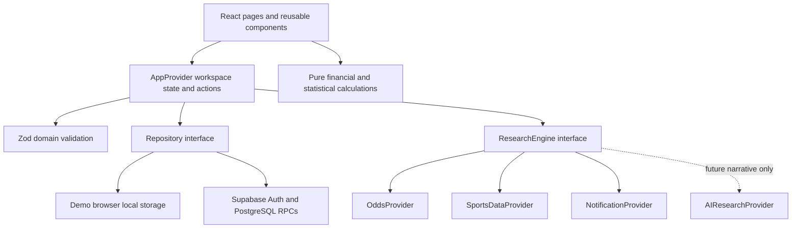

# Architecture

EdgeLab is one maintainable Next.js App Router application. It runs locally without infrastructure. The default workspace is a clearly labelled synthetic demonstration, with browser persistence. An optional Supabase workspace provides authenticated private records and starts empty.

## Boundaries

`src/lib/domain/types.ts` defines shared entities. Bets and paper predictions are distinct collections. Bet legs capture exact markets, selections, thresholds and individual outcomes/statistics. Candidates retain odds and probability provenance. Predictions are registered snapshots; settlement can change outcomes without replacing the original forecast.

`src/lib/domain/calculations.ts` contains pure deterministic functions. Integer cents avoid accumulating floating-point currency errors. Odds multiplication uses integer-scaled arithmetic and rounds payouts once. Charts consume calculated AUD values, never fabricated chart points. Cash ROI excludes bonus results; pending cash reserves reduce available funds. Paper conversion is an explicit helper used only for hypothetical analytics. Multi-sport parlays are counted once as Mixed. See the README for all conventions.

`src/lib/domain/validation.ts` validates persisted workspaces, money limits/precision, UUIDs, timestamps, probabilities, provenance, exact market lines and aggregate/leg settlement consistency. A won bet cannot contain pending/lost legs; a lost bet requires a lost leg; a fully void bet requires all legs void. An overall lost parlay may still contain pending legs because one decisive lost leg determines the aggregate loss.

`src/components/app-provider.tsx` owns current workspace state and user actions. It loads the selected repository, validates snapshots, serializes mutations and updates visible state only after persistence succeeds. A generation guard prevents a completed load/save from replacing another workspace after a mode or auth change. Every ledger edit records a before/after audit; original candidate/probability references are retained. Research and test notifications are restricted to the demo workspace.

Presentation components are client-side interactive views under an App Router shell. Tailwind supplies the dark financial interface; local shadcn/ui components use Radix primitives for buttons/dialog behaviour. Recharts renders responsive analytics. Melbourne display time is explicit; serialized timestamps are UTC ISO strings. No external font or image service is needed to run locally.

## Persistence

The `Repository` contract is `load(): Promise<AppData | null>` and `save(data): Promise<void>`. The local implementation stores one validated snapshot under `edgelab:demo:v1`; it is scoped to the current browser and origin. The Supabase implementation retains a workspace revision and uses an authenticated transactional RPC. Failed writes preserve the prior UI data; stale snapshots require reload instead of blind retry.

The Supabase schema has user profiles, experiment settings, sports, events, bets, legs, financial transactions, candidates, papers, odds snapshots, notifications, runs, model versions and audits. Payload snapshots preserve exact domain round trips; typed/generated relational columns provide numeric constraints, ownership foreign keys and queryable indexes. Monetary columns use NUMERIC. All user tables enforce RLS. Records cannot reference another user's entity by guessing its UUID. See `docs/database.md` for the detailed SQL design.

Auth uses the public Supabase client and email/password sessions. There is no server service-role key, custom password database or hosted backend requirement. RLS is the data security boundary; UI route visibility is not treated as authorization. The local server is for private use and no public account/subscription product is implemented. The singleton client explicitly enables browser session persistence, auto-refresh and implicit URL detection. Sign-up sets an exact `/auth/callback` redirect. The callback uses SDK initialization plus `getUser()` verification, clears token/error URL parameters, and selects the private workspace only on success; it has no arbitrary redirect destination. Auth errors are displayed without logging credentials. Hosted email/provider/URL settings are configured separately in Supabase Dashboard.

The local `.env.local` targets the existing Supabase project and remains ignored; the blank example contains no project credentials. The official CLI is a development dependency, initialized with seeding disabled. Schema changes use ordered migrations, remote history inspection and a read-only dry-run before explicit user approval. The additive hardening migration enforces new snapshot integrity checks and coordinates direct-write revisions with atomic RPC saves; original migration history is preserved. No management token, database password or service-role key is used in application code. CLI login/link is a separate administrative capability from public-key application sign-in.

## Providers and research

`OddsProvider`, `SportsDataProvider`, `ResearchEngine`, `NotificationProvider` and `AIResearchProvider` live in `src/lib/providers/interfaces.ts`.

The mock research workflow loads synthetic odds and synthetic statistics, matches the fixture dataset, registers new candidate snapshots, creates linked in-app alerts and returns a completed simulated run. `estimateSyntheticProbability(wins, trials)` calculates `(wins + 1) / (trials + 2)` from explicitly fictional counts using Laplace smoothing. The exact synthetic wins/trials, formula, `synthetic-frequency-v1` version and timestamp are stored in probability provenance. Historical synthetic ledger/paper snapshots preserve that same computed estimate and source method. The estimator validates integer counts with `0 ≤ wins ≤ trials`; zero observations yield the uninformative 0.5 prior. These observations are invented product fixtures and provide no evidence of forecast quality or betting advantage. Narrative explanations are static. No runtime AI model is called.

Future adapters are explicit stubs. They throw without network requests; selecting or constructing one does not require keys or a paid SDK. The AI interface returns narrative context only and cannot return a numerical probability. A real statistical model must supply its own separately validated estimates, method/version and evidence.

The notification centre persists generated records, read state, dismissal time and history. Dismissal hides an item from active views without removing history. A test alert may also invoke the browser Notification API after permission is granted while the tab is open. No service worker, push subscription, background worker or scheduled job is implemented.

A future scheduled worker can call the research boundary and persist through a carefully scoped server repository. It must preserve provenance, idempotency and private ownership rather than embed ingestion code in the UI.

## Scope and limitations

- Browser-local storage is not an encrypted vault or cross-device backup; export snapshots when needed.
- The whole-workspace RPC suits a small private experiment. Introduce pagination and per-entity writes before large-scale ingestion.
- Manual settlement uses the entered final combined odds. Bookmaker-specific partial void, each-way and unusual promotional rules are outside this MVP.
- Synthetic results only demonstrate calculations. Calibration buckets and Brier values need meaningful real sample sizes before interpretation.
- Live Supabase Auth, email, two-user RLS and remote concurrency require a configured free project and integration validation.
- Provider stubs, background scheduling, live monitoring and browser push infrastructure remain unimplemented.

No code submits wagers, accesses Sportsbet credentials, scrapes bookmakers or transfers funds. The AUD 500 funding reference and AUD 5 default stake are configurable experiment settings, not new restrictions.

## Deployed persistence checkpoint

The two reviewed migrations were applied on 4 November 2026 to the existing project after explicit approval. Exact catalog checks passed for RLS, object definitions and effective permissions; anonymous table/RPC access was rejected live. The separate secure terminal harness subsequently passed 17/17 hosted groups using two dedicated ordinary password-issued sessions, including cross-account bet protection, bookkeeping persistence, SDK restoration, A's browser F5, demo separation and logout. Privileged catalog inspection is never presented as a normal-user RLS test. Positive research/paper/notification writes, email delivery, token expiry and simultaneous transactions remain unverified; see `docs/deployment-verification.md` for exact scope. Test accounts and records are retained.

## Controlled historical archive

Historical intake is a separate bounded context in `src/lib/imports`. It deliberately does not loosen the deployed `AppData`/candidate validators to accommodate incomplete exports. `HistoricalSnapshot` has explicit nulls for unknown facts, while original source text, raw rows, SHA-256, normalization/manual transformations and verification classification are retained. Parser, duplicate detection, deterministic reconciliation and lifecycle commands are independent of presentation and repositories.

`HistoryProvider` sits inside `AppProvider`, selects an independent demo/private historical repository and masks stale state on identity changes. It serializes saves and updates the UI after persistence. Demo history starts empty under `edgelab:history:demo:v1`; private saves use the deployed `edgelab_save_history` RPC and its own revision. A missing hosted migration produces a visible unavailable state, never a demo fallback or automatic deployment. The import UI is keyed by workspace identity so an in-progress preview is not carried across account/mode switches.

The new additive migration prepares six historical tables, owner-composite relationships, nullable NUMERIC projections, source and forecast immutability, append-only audits, lifecycle guards and auth-only SECURITY INVOKER load/save RPCs. It does not alter the existing ledger, settings or RLS policies. It is now explicitly approved and deployed. The earlier two-migration checkpoint above is retained as historical evidence; the current hosted catalog includes all three migrations.

Import confirmation archives approved records only. Actual-ledger registration is a separate explicit per-record financial action, uses the existing audited ledger API and a stable archive UUID, and never infers funding. Paper forecasts and settlement results are separate entities. Registered null-kind records may explicitly be paper-tracked without overwriting their original classification; actual records cannot be converted to paper. Historical notifications deduplicate per source record and retain read/dismiss history. Imported paper metrics are displayed separately, with missing-data exclusions rather than default facts. See [historical-import.md](historical-import.md) for formats and user steps.

## Authentication edge handling

`src/lib/auth/actions.ts` centralizes email/password actions, fixed-origin callback URLs, controlled error messages and local-session logout. Repository operations verify the server identity with SDK `getUser()`; the SDK handles an expired session's refresh before access. Account changes or invalid/revoked sessions fail closed. Signup distinguishes email-confirmation-required from an immediate session; no signup email is generated by local tests. The browser implicit-session architecture and deployed Auth/RLS boundary are preserved.

Installed-SDK tests intercept transport to exercise expiry, refresh, invalid sessions, signup and logout. A separate mocked browser harness intercepts all nonlocal requests for form verification. These local results do not prove real hosted email delivery, confirmation-link routing or long-duration token rotation; the earlier 17/17 hosted report retains its exact scope.

## Research continuity and source intake

`src/lib/handoff` defines the versioned research response contract, semantic/time/probability review, Day 5 checkpoint comparison, owner-attested context journal and prompt generation. It consumes current user-scoped state and returns text; it calls no AI or provider. Raw research responses and context journal entries use the existing historical archive's raw source/rows/transformations. No additional table or migration was needed. Approval atomically appends immutable source records, paper result state and deduplicated historical notifications with one workspace revision. Pass/watch records stay kind-null archives. Actual bets use the existing separate manually confirmed ledger form.

`src/lib/conversation-import` parses only a file explicitly selected by the user. It presents conversation/branch/message selection and explicit manual record mapping, preserves message IDs and source timestamps as provenance, and hands a selected-source envelope to the existing review wizard. It never infers betting facts from prose. The complete selected conversation is retained; other conversations are excluded. The original full-export hash records provenance without storing all unrelated conversations.

`ResearchHandoff` is keyed by mode/user identity and uses the existing state providers. Context completeness, latest confirmed day, unresolved results, missing evidence and the unverified checkpoint remain explicit. A generated prompt is not a research run or a completed-day attestation. Response review rechecks temporal/freshness constraints at confirmation. No historical forecast can be retrospectively rewritten.

`src/lib/notifications/paper-reminders.ts` creates a distinct source-linked pending-paper reminder in the existing notification collection. Its stable source UUID prevents repeated alerts; it does not reset read/dismiss history or mutate forecasts/finances. Historical research alerts retain their existing one-per-record identity. Notifications have no background delivery infrastructure.

The optional The Odds API readiness factory is server-only and disabled by default. Its injected transport adapter validates quota, timestamps and precise market identities. It has no route, poller or connection to Research Handoff. Demo fallback is clearly synthetic; a private disabled adapter returns no synthetic markets. See the odds runbook for process-local quota limitations.

The historical schema is now approved/deployed. Exact catalog, anonymous and 11 ordinary-user read/negative checks passed; positive hosted research lifecycle is still separately unverified because private storage rejects synthetic sources. Never relabel a fixture to make a hosted write pass. Read [research-continuity.md](research-continuity.md) and the current verification report for complete boundaries.

## Personal workspace and supplementary review

`workspace-verification.ts` accepts only existing-identity/read capabilities and returns a sanitized report. Its Settings panel uses the current Supabase singleton and normal repositories, checks identity before/after parallel reads, and discards mismatched results. It never writes or requests credentials.

`imports/paper-supplement.ts` extends the existing staging adapter, not database storage. It retains two immutable local source manifests, reconciles described paper counts, flags uncertain identities and excludes exact duplicate rows without merging evidence. `review-warnings.ts` derives review classes without altering strict hosted payloads. Recovered summary records remain excluded from forecast accuracy/Brier calculations even if a later result is recorded. All migration files and hosted ownership/provenance rules remain unchanged.

## Versioned memory and owner checkpoints

`handoff/methodology.ts` uses v2 raw context envelopes in the existing immutable journal; source snapshots/SQL shapes are unchanged. Day-only journals retain earlier methodology/original rules. `continuity-evidence.ts` re-parses hashed local source manifests, with explicit per-account browser retention independent of Supabase records. `owner-checkpoint.ts` maps owner placement claims into existing nullable historical snapshots; reported quotes/ranges remain source metadata and previews cannot commit before separate approval. Handoff groups and provisional financial context never enter actual bankroll calculations.

Research response v1 retains backwards compatibility with optional nullable `createdAt`. Application session/content and semantic selection guards recheck loaded records and staged proposals at confirmation. Existing SQL uniqueness/revision/RLS controls remain unchanged. CLV is a separate pure calculation helper and has no live provider or persistence claim. See [research memory](research-memory.md).
